<p align="center">
  
</p>

<p align="center">
  <a href="https://tamimlabs.com"></a>
  <a href="https://tamimlabs.com/tools"></a>
  <a href="mailto:hello@tamimlabs.com"></a>
  <a href="https://github.com/tamimlabs?tab=followers"></a>
  <a href="https://www.supportkori.com/tamimlabs"></a>
  <br/>
  <!-- ⚡ LIVE SHIELDS — auto-update, no heavy cards -->
  
  
  
  
  <a href="https://devpost.com/tamimlabs"></a>
</p>

---

### 🙋‍♂️ Hey, I'm Tamim

Most devs pick one road. I walk two.

> **By day I study to become a doctor. By night I build software** — download engines in Rust, AI agents in Python, Windows utilities in C#, browser tools in TypeScript. Same mindset in both worlds: diagnose carefully, treat precisely, do no harm.

I run **[Tamim Labs](https://tamimlabs.com)** — an independent venture where the person who writes the code is the person you talk to. No agency layer, no ticket queue.

```python
class TamimHasan:
    username = "tamimlabs"
    location = "Bangladesh"
    venture  = "Tamim Labs — thoughtful engineering, useful technology"
    roles    = ["Full-Stack Developer", "Open-Source Builder", "Future Doctor, Inshallah"]

    passions = ["desktop apps", "browser tools", "AI agents", "computer vision",
                "automation", "games", "robotics"]
    currently_deep_into = ["Rust", "Tauri 2", "C# / Win32", "systems engineering"]
    philosophy = "fast · clean · private · honest"

    def motto(self):
        return "A dreamer who ships 🩺 + 💻"
```

- 🔭 Right now: **Your Download Manager (YDM)** — segmented downloads + torrents + HLS + site extraction in one Tauri app
- 🆕 Just shipped: **TimeLock** — a Windows focus lock that survives restarts, built with the C# compiler that already ships inside Windows
- 🧰 Side quest: **19 free browser tools**, 18 of which never send your data anywhere
- 🌱 Leveling up: **Rust, Tauri internals, download protocols (aria2 / libtorrent / FFmpeg), WebExtensions**
- 💬 Ask me about: Tauri 2, Svelte 5, Gemini + ADK agents, OpenCV, yt-dlp pipelines, Arduino PID robots
- 📬 Inbox open: **hello@tamimlabs.com**

---

### 🧩 What I actually build

```
🖥️ DESKTOP & SYSTEMS          🤖 AI & VISION                🌐 WEB & GAMES              🧩 BROWSER & AUTOMATION
─────────────────────         ──────────────────            ─────────────────          ─────────────────────────
Tauri 2 · Rust · Svelte       Gemini · ADK · DeepFace       React · Next · Svelte      Manifest V3 · WebExtensions
C# · .NET · Win32             FER · OpenCV DNN              Tailwind · Vanilla JS      n8n · Telegram bots
aria2 · libtorrent            Cloud Run · Firestore         Cloudflare Pages           MoviePy · FFmpeg · Arduino
```

---

### 🚀 Tamim Labs — what's live

> Real status, honestly stated. Nothing gets called shipped before it ships.

| Product | What it does | Stack | Status |
|---|---|---|---|
| **[TimeLock](https://tamimlabs.com/products/timelock)** | Timed Windows lock for deep work — stores the *end time*, not a countdown, and enforces it with a SYSTEM scheduled task. Restart the laptop, the lock is still there. | C# · .NET Framework · Win32 · Task Scheduler | ✅ **Available** |
| **[Your Download Manager](https://tamimlabs.com/products/your-download-manager)** | My flagship. Segmented HTTP/FTP, BitTorrent, HLS, YouTube/Twitch/Vimeo extraction, one-click browser handoff. Zero telemetry by design. | Rust · Tauri 2 · Svelte 5 · aria2 · libtorrent | 🚧 **In development** (private testing) |
| **[Browser Download Companion](https://tamimlabs.com/products/browser-download-companion)** | The browser half of YDM — Chrome, Edge and Firefox send any download to the app in one click. | JavaScript · Manifest V3 | 🚧 **In development** |
| **[NexusMind AI](https://tamimlabs.com/products/nexusmind-ai)** | One sentence in → planned, executed, self-corrected task run out. Built solo for Google's "All Things Agentic" hackathon. | Python · FastAPI · Gemini · Google ADK | 🧪 **Prototype** |

**Free tools, 19 of them** — 18 run entirely in your browser, no account, nothing stored. The AI image generator is the only one that talks to a server.

| Category | Tools |
|---|---|
| Developer | [JSON formatter](https://tamimlabs.com/json) · [JWT inspector](https://tamimlabs.com/jwt) · [Key pair generator](https://tamimlabs.com/keygen) · [13-in-one devtools](https://tamimlabs.com/devtools) (Base64, URL, UUID, hashes, HMAC, passwords, diff…) |
| Media | [Image compressor](https://tamimlabs.com/image) · [Media converter](https://tamimlabs.com/media) · [Metadata inspector](https://tamimlabs.com/metadata) |
| Documents | [PDF merge / split / rotate / metadata](https://tamimlabs.com/pdf) |
| Everyday | [QR generator & scanner](https://tamimlabs.com/qr) · [Text toolkit](https://tamimlabs.com/text) |

---

### 🔥 Selected work

**🎬 Social Media Automation** `Python · n8n · Gemini · MoviePy` — [code](https://github.com/tamimlabs/social-media-automation) · [hackathon](https://devpost.com/software/social-media-automation-orz4ve)
<br/>Zero-cost pipeline: raw video + prompt → captioned 9:16 clip, auto-edited, auto-published via Telegram + n8n.

**👁️ Imotion Detector** `Python · OpenCV · DeepFace · FER` — [code](https://github.com/tamimlabs/Imotion-detector)
<br/>Real-time facial emotion detection with 3 swappable engines so you can trade accuracy for speed per device.

**⚔️ Cyber Clash 2077** `HTML · CSS · JS` — [🎮 play it](https://tamimlabs.github.io/cyber-clash-2077/) · [code](https://github.com/tamimlabs/cyber-clash-2077)
<br/>50-level cyberpunk browser fighter, 5 story arcs, 5 bosses. Zero backend, pure front-end juice.

**🌐 tamimlabs.com** `Next.js · TypeScript · Tailwind` — [visit](https://tamimlabs.com)
<br/>My portfolio *and* my products page, hand-built: custom design system, structured data, an AI assistant, 19 working tools, statically exported. No templates, no page builders.

**🦊 Firefox extensions** `JavaScript · WebExtensions`
<br/>[insta-video-controller](https://github.com/tamimlabs/insta-video-controller) — real video controls on Instagram; [firefox-theme-template](https://github.com/tamimlabs/firefox-theme-template) — a themed-extension starter kit with build scripts and CI.

**🕌 Porda-AI** `JavaScript · on-device ML` — [my fork](https://github.com/tamimlabs/Porda-AI) · [upstream](https://github.com/hijam-git/Porda-AI)
<br/>Real-time, on-device modesty filter that blurs NSFW content on any screen — offline, online, in browser or video player. Upstream project by [@hijam-git](https://github.com/hijam-git); I fork it, test it, and contribute back.

**🔌 PID Line-Follower Robot** `Arduino C++ · U8g2 · EEPROM`
<br/>Nano + L298N + 14× TCRT sensors through a 16-ch mux + OLED menu + EEPROM-tuned PID. Real hardware, real tuning pain.

**🎞️ STICK: A Stickman Epic** `Python · MoviePy · FFmpeg`
<br/>CLI movie studio — scripted scenes render to video, a full soundtrack gets synthesized, then muxed into a final MP4.

---

### 🧰 Toolbox

<p align="center">
  
  <br/>
  
  <br/>
  
</p>

<details>
<summary><b>📦 Full list (click)</b></summary>
<br/>

**Front-End:** HTML5 · CSS3 · JavaScript ES6+ · TypeScript · React · Next.js · Svelte 5 · Tailwind
**Back-End:** Node.js · Express · REST APIs · Python · FastAPI
**Desktop / Systems:** Tauri 2 · Rust · C# · .NET Framework · Win32 · aria2 · libtorrent · yt-dlp
**Browser:** Manifest V3 · WebExtensions (Chrome / Edge / Firefox)
**AI / Vision:** Gemini AI · Google ADK · OpenCV · DeepFace · FER · MoviePy · FFmpeg
**Data:** MongoDB · PostgreSQL · MySQL · Firestore
**Cloud / Tools:** Git · GitHub Actions · VS Code · Postman · Vercel · Cloud Run · Pub/Sub · n8n · PowerShell

</details>

---

## 💖 Support

If my work helps you, please consider supporting it:

<p align="center">
  <a href="https://www.supportkori.com/tamimlabs"></a>
</p>

> Every donation via [supportkori.com/tamimlabs](https://www.supportkori.com/tamimlabs) keeps privacy-first open source alive. Thank you!

---

### 🏆 Hackathons & proof

| Hackathon | Build | Proof |
|---|---|---|
| Google — All Things Agentic | 🧠 NexusMind AI | [repo](https://github.com/tamimlabs/nexusmind-ai) · [demo](https://youtu.be/57qWqvspqjs) · [devpost](https://devpost.com/tamimlabs) |
| Automation / AI video | 🎬 Social Media Automation | [repo](https://github.com/tamimlabs/social-media-automation) · [devpost](https://devpost.com/software/social-media-automation-orz4ve) |

---

### 🎬 Fresh from YouTube

<!-- YOUTUBE:START -->
- [This AI Agent Is Gonna Make Your Life Easier](https://www.youtube.com/watch?v=57qWqvspqjs)
- [I Built an Autonomous AI Agent That Executes Tasks on Its Own | NexusMind AI](https://www.youtube.com/watch?v=woSOCuzfabg)
<!-- YOUTUBE:END -->

---

### 🐍 Contributions

<p align="center">
  <picture>
    <source media="(prefers-color-scheme: dark)" srcset="https://raw.githubusercontent.com/tamimlabs/tamimlabs/output/github-contribution-grid-snake-dark.svg"/>
    <source media="(prefers-color-scheme: light)" srcset="https://raw.githubusercontent.com/tamimlabs/tamimlabs/output/github-contribution-grid-snake.svg"/>
    
  </picture>
</p>

---

### 💌 Let's connect

I'm always up for collabs, client work, feedback on YDM, hackathons, or just nerding out over Rust + Svelte.

<p align="center">
  <a href="https://tamimlabs.com"></a>
  <a href="https://github.com/tamimlabs"></a>
  <a href="mailto:hello@tamimlabs.com"></a>
  <a href="https://devpost.com/tamimlabs"></a>
  <a href="https://youtube.com/@tamimlabs"></a>
  <a href="https://facebook.com/tamimlabs"></a>
</p>

<p align="center">
  
  <br/>
  
</p>



<p align="center"><i>© 2026 Tamim Hasan · Bangladesh · Built with curiosity, care, and way too much ☕</i></p>
